# Production Flask + MongoDB on Kubernetes (Minikube)

A production-grade, highly available deployment of a Python Flask application connected to an authenticated MongoDB database running on a local Minikube Kubernetes cluster.

---

## 1. Overview & Architecture

The architecture consists of a 2-tier microservice model deployed in a dedicated `flask-app` namespace:
- **Frontend / API Tier**: Horizontally scalable Flask application served via Gunicorn WSGI workers, exposed externally via a `NodePort` Service, and managed by a Horizontal Pod Autoscaler (HPA v2) and a PodDisruptionBudget (PDB).
- **Database Tier**: Persistent MongoDB stateful instance managed by a `StatefulSet`, paired with a headless `ClusterIP` Service for deterministic DNS resolution, backed by a persistent `hostPath` Volume Claim.
- **Security & Networking**: Credentials stored in Kubernetes Secrets and injected safely as environment variables, with strict resource requests/limits and NetworkPolicy ingress isolation.

> [!NOTE]
> **NetworkPolicy CNI Enforcement**: Kubernetes NetworkPolicies require a CNI network plugin that supports enforcement (such as Calico via `minikube start --cni=calico`). On a default Minikube cluster using the standard driver and CNI, the NetworkPolicy manifest is accepted and stored by the API server, but network rules are **not actively enforced**. For full ingress isolation in production, start Minikube with `--cni=calico`.

### Architecture Diagram

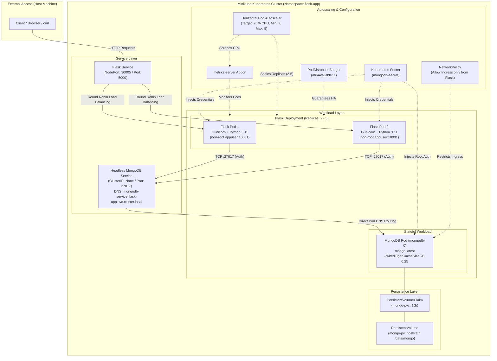

---

## 2. Prerequisites & Verified Tooling

The environment was validated and verified on the local host before execution:

| Tool | Verified Version | Purpose |
| :--- | :--- | :--- |
| **Python** | `Python 3.15.2` (Host) / `Python 3.9.13` (venv) | Application development & virtual environment |
| **pip** | `pip 26.2.2` | Dependency management |
| **Docker** | `29.9.3` (build 5457199) | Container engine & Minikube VM driver |
| **Minikube** | `v1.39.0` (commit 7a9f6a8) | Local single-node Kubernetes cluster |
| **kubectl** | Client `v1.36.1` (Server `v1.37.0`) | Cluster CLI management |
| **Git** | `2.56.0.windows.4` | Version control |
| **curl** | `curl 8.21.0` | HTTP client for verification |
| **Docker Hub** | Account: `avinashsingh231` | Image repository namespace |

---

## 3. Quick Start

Deploy the entire infrastructure with a single script:

### Linux / macOS / WSL2
```bash
cd flask-mongodb-k8s

# 1. Build and load the Docker image into Minikube
./deploy.sh build
./deploy.sh load

# 2. Deploy all manifests and wait for readiness
./deploy.sh deploy

# 3. Test all endpoints
./deploy.sh test
```

### Windows (PowerShell)
```powershell
cd flask-mongodb-k8s

# 1. Build and load the Docker image into Minikube
.\deploy.ps1 -Action build
.\deploy.ps1 -Action load

# 2. Deploy all manifests and wait for readiness
.\deploy.ps1 -Action deploy

# 3. Test all endpoints
.\deploy.ps1 -Action test
```

---

## 4. Detailed Step-by-Step Deployment on Minikube

### Step 1: Start Minikube Cluster
Start Minikube with the Docker driver allocating at least 2 CPUs and 4096MB memory:
```bash
minikube start --driver=docker --cpus=2 --memory=4096
```

### Step 2: Enable the Metrics Server Addon
The Horizontal Pod Autoscaler requires `metrics-server` to collect pod CPU metrics:
```bash
minikube addons enable metrics-server
```

### Step 3: Build & Load the Docker Image
```bash
# Build locally
docker build -t avinashsingh231/flask-mongodb-app:v1.0.0 ./app

# Load directly into Minikube's container runtime
minikube image load avinashsingh231/flask-mongodb-app:v1.0.0
minikube image load mongo:latest
```

### Step 4: Apply Kubernetes Manifests in Numeric Order
Manifests are structured cleanly in `k8s/` and must be applied sequentially:

```bash
# 00. Create dedicated namespace
kubectl apply -f k8s/00-namespace.yaml

# 01. Create Secret with credentials
kubectl apply -f k8s/01-secret.yaml

# Pre-create hostPath directory (root-owned by default; mongod runs as non-root UID 999)
minikube ssh "sudo mkdir -p /data/mongo && sudo chmod 777 /data/mongo"

# 02. Create PersistentVolume and PersistentVolumeClaim
kubectl apply -f k8s/02-mongo-pv-pvc.yaml

# 03 & 04. Deploy MongoDB Headless Service and StatefulSet
kubectl apply -f k8s/04-mongo-service.yaml
kubectl apply -f k8s/03-mongo-statefulset.yaml

# Wait for MongoDB initialization and readiness
kubectl wait --for=condition=ready pod/mongodb-0 -n flask-app --timeout=120s

# 05 & 06. Deploy Flask Deployment and NodePort Service
kubectl apply -f k8s/05-flask-deployment.yaml
kubectl apply -f k8s/06-flask-service.yaml

# Wait for Flask deployment rollout
kubectl rollout status deployment/flask-deployment -n flask-app --timeout=120s

# 07. Deploy HorizontalPodAutoscaler
kubectl apply -f k8s/07-hpa.yaml

# 08 & 09 (Bonuses). Deploy NetworkPolicy and PodDisruptionBudget
kubectl apply -f k8s/08-networkpolicy.yaml
kubectl apply -f k8s/09-pdb.yaml
```

> **Note on Storage**: `deploy.sh` and `deploy.ps1` automatically wipe and recreate `/data/mongo` inside Minikube on each deploy run to guarantee a clean, uncorrupted database state for authentication bootstrapping.

### Step 5: Verify Deployment Status
```bash
kubectl get all,pv,pvc,hpa,pdb,netpol -n flask-app
```

### Step 6: Access the Application
Get the URL exposed by the NodePort service:
```bash
minikube service flask-service -n flask-app --url
# Alternatively, establish a direct port-forward:
kubectl port-forward svc/flask-service -n flask-app 5000:5000
```

---

## 5. Docker Build and Push Instructions

### Local Build
```bash
docker build -t avinashsingh231/flask-mongodb-app:v1.0.0 ./app
```

### Push to Docker Hub
To push the image to Docker Hub under your username:
```bash
# 1. Login to Docker Hub (prompts for your password / Personal Access Token)
docker login -u avinashsingh231

# 2. Tag explicitly (already tagged during build, but shown for completeness)
docker tag avinashsingh231/flask-mongodb-app:v1.0.0 avinashsingh231/flask-mongodb-app:v1.0.0

# 3. Push to registry
docker push avinashsingh231/flask-mongodb-app:v1.0.0
```

### Minikube Alternative (`minikube image load`)
To deploy locally without pushing to Docker Hub or needing credentials:
```bash
minikube image load avinashsingh231/flask-mongodb-app:v1.0.0
```
*Note on `eval $(minikube docker-env)`*: On Linux/macOS or bash shells, executing `eval $(minikube docker-env)` points your host `docker` CLI directly to Minikube's internal Docker daemon, allowing you to build directly inside Minikube (`docker build -t avinashsingh231/flask-mongodb-app:v1.0.0 ./app`) without copying layers.

---

## 6. Virtual Environment Benefits

Using Python virtual environments (`venv`) provides critical engineering advantages:
1. **Dependency Isolation**: Prevents dependency version conflicts between different projects on the same machine.
2. **Version Pinning & Reproducibility**: Guarantees that exact specified versions (`Flask==2.0.2`, `Werkzeug==2.0.3`, `pymongo==3.12.0`) are installed without unexpected updates or breaking changes from newer upstream packages.
3. **Host System Protection**: Leaves the global operating system Python environment clean and unpolluted, eliminating the risk of breaking system packages or OS tools that depend on system Python.
4. **Environment Determinism**: Mirroring production dependencies in a local virtual environment eliminates "works on my machine" bugs prior to containerization.

---

## 7. DNS Resolution Deep Dive

Kubernetes provides built-in DNS management via **CoreDNS**.

### Standard Services vs. Headless Services
- **Standard Service (`flask-service`)**:
  - Kubernetes assigns a virtual IP (`ClusterIP: 10.97.150.249`).
  - CoreDNS resolves `flask-service.flask-app.svc.cluster.local` to this single ClusterIP.
  - `kube-proxy` (via iptables or IPVS) load-balances traffic arriving at the ClusterIP across the ready backend pods.

- **Headless Service (`mongodb-service` with `clusterIP: None`)**:
  - CoreDNS does **not** assign a virtual cluster IP.
  - Instead, DNS queries for `mongodb-service.flask-app.svc.cluster.local` return direct `A` records containing the IP addresses of all backing pods (`10.244.0.9`).
  - Furthermore, pairing with a `StatefulSet` enables **predictable, per-pod DNS records**:
    $$\text{pod-name}.\text{service-name}.\text{namespace}.\text{svc}.\text{cluster}.\text{local}$$
    For pod index 0:
    ```
    mongodb-0.mongodb-service.flask-app.svc.cluster.local
    ```
  - This guarantees the Flask application connects directly to the dedicated MongoDB instance without intermediary proxy layers.

### Configuration in Flask
The Flask application reads `MONGO_HOST` from the environment:
```yaml
env:
  - name: MONGO_HOST
    value: "mongodb-service.flask-app.svc.cluster.local"
```
No hardcoded IP addresses are used. If Flask and MongoDB reside in the same namespace, the short name `mongodb-service` also resolves correctly via the search domain configuration in `/etc/resolv.conf`.

---

## 8. Resource Requests and Limits Deep Dive

Kubernetes container resource management separates **Scheduling** from **Enforcement**:

| Metric | Requests | Limits |
| :--- | :--- | :--- |
| **CPU** | `200m` (0.2 cores) | `500m` (0.5 cores) |
| **Memory** | `250M` (250 Megabytes) | `500M` (500 Megabytes) |

### Requests (Scheduling)
- **What it is**: The guaranteed baseline resources reserved for the container.
- **How it works**: The Kubernetes `kube-scheduler` calculates node capacity based on the sum of container *requests*. A node with 2 CPUs will only accept pods whose combined CPU requests are $\le$ 2 CPUs.
- **HPA Relationship**: The Horizontal Pod Autoscaler calculates target CPU utilization as a percentage of **requests**, NOT limits:
  $$\text{Utilization \%} = \frac{\text{Current CPU Usage}}{\text{CPU Request (200m)}} \times 100$$
  Therefore, an HPA target of 70% triggers scaling when pod CPU consumption exceeds:
  $$200\text{m} \times 0.70 = 140\text{m}$$

### Limits (Enforcement & Throttling vs OOMKill)
- **CPU Limits (Throttling)**: CPU is a compressible resource. When a container attempts to consume more CPU than its limit (`500m`), the Linux kernel CFS (Completely Fair Scheduler) **throttles** execution cycles. The process is never killed; it simply runs slower.
- **Memory Limits (OOMKill)**: Memory is an incompressible resource. When a container exceeds its memory limit (`500M`), the Linux kernel cgroup memory controller terminates the process immediately with a **SIGKILL (Exit Code 137)** (`OOMKilled`).
- **Mitigation for MongoDB**: Because MongoDB's default WiredTiger storage cache attempts to use 50% of total host RAM (which in our 16GB system would consume 8GB), running without tuning inside a 500M limit would trigger an immediate OOMKill. We explicitly configure `--wiredTigerCacheSizeGB 0.25` (256MB) in the StatefulSet container `args`, ensuring the WiredTiger storage engine cache remains safely within the 500M container threshold.

---

## 9. Design Choices & Trade-off Analysis

| Decision | Selected Choice | Alternative Considered | Why the Selected Choice Won & Why Alternative Was Rejected |
| :--- | :--- | :--- | :--- |
| **MongoDB Workload** | **StatefulSet** | Deployment | **StatefulSet** provides stable persistent network IDs (`mongodb-0`), ordered startup/shutdown, and dedicated persistent storage binding. **Deployment** was rejected because pods are ephemeral and fungible; restarting a deployment can attach volumes to new random pod names and break stateful data persistence. |
| **MongoDB Service** | **Headless ClusterIP (`None`)** | ClusterIP / NodePort | **Headless Service** allows direct DNS addressing to the individual pod (`mongodb-0.mongodb-service`) and avoids unnecessary NAT/proxy overhead. Exposing via **NodePort** was rejected as a severe security vulnerability (database should never be directly accessible from the public network). |
| **Credentials** | **Kubernetes Secret** | ConfigMap / Plaintext | **Secret** (`type: Opaque`) encrypts/obfuscates credentials and integrates with Kubernetes RBAC and audit logging. **ConfigMap** was rejected because it is intended strictly for non-sensitive configuration; storing passwords in ConfigMaps exposes plaintext credentials in cluster logs and git repositories. |
| **Storage Class** | **hostPath PV + PVC** | Dynamic Provisioning (`hostpath-storage`) | **Static hostPath PV (`02-mongo-pv-pvc.yaml`)** satisfies the strict assignment contract requiring a dedicated `PersistentVolume` bound to a `PersistentVolumeClaim` with `storageClassName: manual`. While Minikube supports dynamic storage provisioners, static binding gives deterministic control over the exact host mount path (`/data/mongo`). |
| **Flask Expose** | **NodePort** | LoadBalancer / Ingress | **NodePort** natively works out-of-the-box on local Minikube without external cloud infrastructure or configuring ingress controllers. **LoadBalancer** requires `minikube tunnel` running in privileged mode, and **Ingress** requires additional ingress-nginx addons. |
| **MongoDB Topology** | **Standalone Instance** | Multi-node Replica Set | **Standalone** satisfies all assignment requirements while staying strictly within the 2 CPU / 4GB Minikube intern resource constraints. A 3-node **Replica Set** was rejected because it triples resource consumption (1.5GB RAM minimum) and requires complex election orchestration not required for this tier. |
| **WSGI Server** | **Gunicorn** | Flask Built-in Dev Server | **Gunicorn** is a battle-tested, pre-fork worker WSGI server that handles concurrent connections, request timeouts, and worker worker-recycling. Flask's built-in `werkzeug` server is single-threaded, explicitly unsuited for production, and lacks proper concurrency. |
| **Liveness vs Readiness Probe Architecture** | **Liveness on `/`, Readiness on `/health`** | Liveness on `/health` | **Liveness** validates strictly that the Flask process and Gunicorn WSGI workers are responsive (`/`), completely decoupled from downstream database state. **Readiness** validates end-to-end traffic capacity by pinging MongoDB via `/health`. **Alternative considered**: Binding liveness to `/health` was explicitly rejected because database throttling or high latency causes the kubelet to terminate healthy application pods, triggering a catastrophic restart cascade. |
| **MongoDB Probe Mechanism** | **Native `tcpSocket` on `:27017`** | `exec mongosh` CLI ping | **`tcpSocket` probes** execute natively within the kubelet kernel network stack with virtually zero CPU overhead, guaranteeing reliable health checks even when the database is under maximum load. **Alternative considered**: Running `exec mongosh` spawns an entire Node.js V8 process inside the container's 500m CPU limit; under heavy concurrency, Node.js startup exceeded probe timeouts (10s), causing spurious container restarts. **Trade-off**: A TCP probe confirms that the socket accepts connections, but does not verify authentication (auth is verified separately via test suites). |
| **NetworkPolicy Ingress** | **Declared (Targeted Ingress)** | Open Namespace Networking | **NetworkPolicy** enforces the principle of least privilege by restricting MongoDB ingress to pods matching label `app.kubernetes.io/name: flask-app`. **CNI note**: NetworkPolicy enforcement requires a compatible CNI plugin (e.g. `minikube start --cni=calico`); on default Minikube the manifest is accepted by the API server but not actively enforced. |

---

## 10. Testing Scenarios & Verification Results

All tests were executed against the live cluster. Raw execution logs are saved in `tests/`:

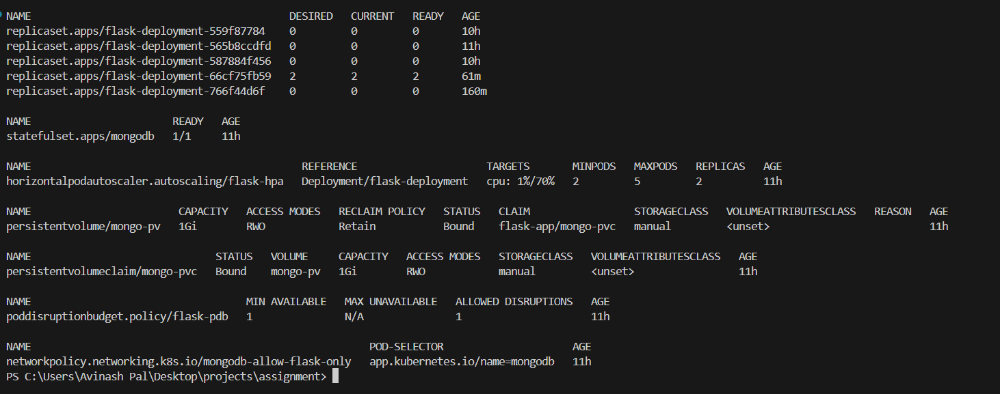
*All cluster workloads in the `flask-app` namespace running and ready.*

### 1. Database CRUD Verification (`tests/01_database_crud.log`)
- `GET /health` -> `HTTP 200 OK` (`{"database":"connected","status":"healthy"}`)
- `GET /` -> `HTTP 200 OK` (`Welcome to the Flask app! The current time is: ...`)
- `POST /data` with valid JSON -> `HTTP 201 CREATED` (`{"status":"Data inserted"}`)
- `GET /data` -> `HTTP 200 OK` (`[{"source":"minikube-k8s","status":"success"}, ...]`)
- `POST /data` with invalid non-JSON -> `HTTP 400 BAD REQUEST` (`{"error":"Invalid or missing JSON payload"}`)

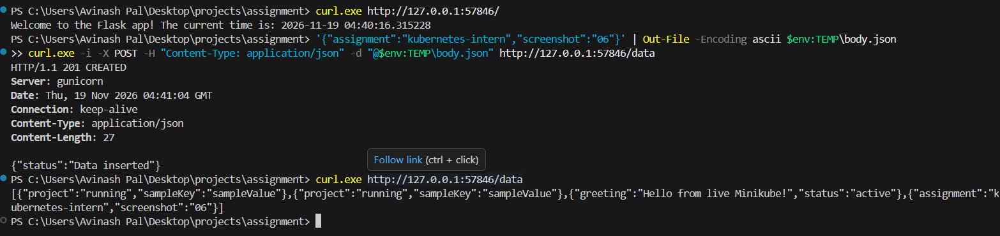
*All application endpoints verified working with correct HTTP status codes and responses.*

### 2. MongoDB Authentication Verification (`tests/02_auth_verification.log`)
Demonstrated inside the cluster via in-cluster client:
- **No Credentials**: Access refused by MongoDB engine:
  `OperationFailure: Command find requires authentication (code: 13, Unauthorized)`
- **Incorrect Credentials**: Authentication rejected:
  `OperationFailure: Authentication failed (code: 18, AuthenticationFailed)`
- **Correct Credentials from Secret**: Authenticated and document retrieved:
  `AUTHENTICATED SUCCESSFULLY -> Document: {'source': 'minikube-k8s', 'status': 'success'}`

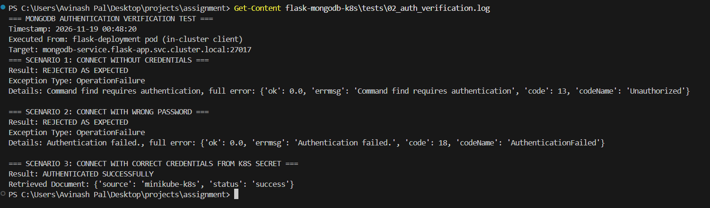
*Authentication verification proving unauthorized access is blocked while valid secret credentials succeed.*

### 3. Data Persistence Verification (`tests/03_data_persistence.log`)
- Inserted unique test record: `{"test_id":"persistence-712421697"}` via `POST /data`.
- Forcibly deleted the `mongodb-0` pod: `kubectl delete pod mongodb-0 -n flask-app`.
- Waited for StatefulSet to spin up a new replacement pod and pass readiness checks.
- Queried `GET /data`: Document `persistence-712421697` was intact and returned immediately from the mounted `hostPath` volume.

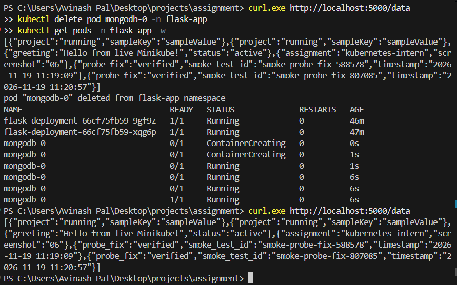
*Persistent storage validation: MongoDB data persists across pod recreation via hostPath PV.*

### 4. Zero-Downtime Resilience Test (`tests/04_resilience_pod_failure.log`)
- Sent 15 continuous HTTP requests while simultaneously executing `kubectl delete pod` on one of the active Flask pods.
- Result: **15 / 15 requests succeeded with HTTP 200 (100% availability)**.
- `flask-service` seamlessly routed traffic to the healthy replica, while the Deployment and PDB spawned a replacement pod.

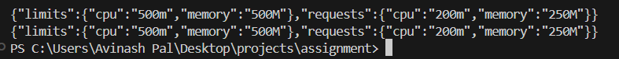
*Zero downtime and resource enforcement during pod termination and rescheduling.*

### 5. Horizontal Pod Autoscaler (HPA) Load Test (`tests/05_hpa_watch.log`, `tests/05_hpa_describe.log`)

The autoscaling behavior was verified after decoupling Flask's liveness probe from MongoDB by generating synthetic CPU load using an in-cluster `load-gen` deployment (`busybox`). The traffic generator executed parallel continuous HTTP `wget` loops against `http://flask-service:5000/`.

**Why the root endpoint (`/`) was targeted**:
Testing targeted `GET /` instead of `/data` to isolate and directly exercise Flask application processing and Gunicorn WSGI CPU utilization under concurrency, without generating downstream MongoDB query contention, WiredTiger cache pressure, or host disk I/O bottlenecks.

#### Test Execution Timeline

Data captured from live watch (`tests/05_hpa_watch.log`) and verified against HPA controller events (`tests/05_hpa_describe.log`):

| Timestamp (HH:mm:ss) | Phase | Target Metric (% of 200m request) | Current Replicas | Cluster Observations & Event Correlation |
| :--- | :--- | :--- | :--- | :--- |
| **11:25:25** | Baseline Idle | 2% / 70% | 2 | Minimum baseline replicas; application idle prior to traffic injection |
| **11:25:26** | Baseline Idle | 1% / 70% | 2 | Metrics stable at low CPU usage (~2m–4m per pod) |
| **11:26:26** | Pre-load Idle | 3% / 70% | 2 | Pre-test idle check; cluster healthy |
| **11:27:27** | Load Injected | **129% / 70%** | 2 | Traffic starts; first reading above 70% threshold (258m avg / pod) |
| **11:27:42** | Scale-Up Triggered | **129% / 70%** | **4 (Scaled)** | Exactly 15s after spike: HPA rescales to 4 replicas (`New size: 4`) |
| **11:28:28** | Load Absorption | 88% / 70% | 4 | Load distributed across 4 pods; per-pod CPU begins normalizing |
| **11:29:28** | Steady-State Load | 67% / 70% | 4 | CPU enters HPA 10% tolerance band ([63%–77%]); scaling stabilizes |
| **11:31:30 – 11:35:32** | Sustained Traffic | 65% – 68% / 70% | 4 | Consistent concurrency across 4 pods (65%, 66%, 67%, 68%, 68%) |
| **11:36:33** | Late Load Phase | 61% / 70% | 4 | Stable throughput maintained with 0 container restarts |
| **11:37:33** | Load Generator Deleted | 1% / 70% | 4 | `load-gen` deleted; traffic terminates; CPU immediately collapses to 1% |
| **11:38:18** | Cool-down Window | 1% / 70% | 4 | 60-second scale-down stabilization window actively running |
| **11:38:33** | Scale-Down Triggered | **2% / 70%** | **2 (Baseline)** | Exactly 60s post-traffic: HPA rescales to baseline (`New size: 2`) |
| **11:41:33 – 11:42:33** | Post-Test Idle | 1% – 2% / 70% | 2 | Baseline restored; cluster 100% healthy with 0 restarts |

#### Autoscaling Behavior Analysis & Interpretation

- **Scale-Up Responsiveness (15 seconds)**:
  From the first high-CPU reading (`11:27:27` at 129%) to the deployment reaching 4 replicas (`11:27:42`), scaling took exactly **15 seconds**. This directly corresponds to the Kubernetes HPA evaluation cadence (`--horizontal-pod-autoscaler-sync-period` = 15s) and the HPA `scaleUp` policy (`selectPolicy: Max`, `type: Pods, value: 2, periodSeconds: 15`), scaling immediately by 2 pods without an artificial scale-up stabilization delay (`stabilizationWindowSeconds: 0`).
- **Scale-Down Stabilization (60 seconds)**:
  Once the load generator was deleted, CPU dropped to 1% at `11:37:33`. The HPA maintained 4 replicas until `11:38:33` (exactly **60 seconds**), obeying `behavior.scaleDown.stabilizationWindowSeconds: 60` to protect against traffic thrashing/flapping before cleanly consolidating back to the baseline of 2 replicas.
- **Why Peak Replicas Reached 4 (Not 5)**:
  The deployment peaked at **4 replicas** and did not scale to the maximum of 5. When the 2 original pods were scaled to 4, the deployment's aggregate CPU request pool expanded from 400m to 800m ($4 \times 200\text{m}$). The concurrent load was absorbed across the 4 pods at ~130m–136m each, resulting in 65%–68% utilization. Because Kubernetes HPA implements a default **10% tolerance band** around the target utilization ($\frac{|67\% - 70\%|}{70\%} = 4.3\% < 10\%$), any metric between 63% and 77% does not trigger an autoscaling adjustment. Consequently, the cluster stabilized cleanly at 4 replicas.
- **Metrics Integrity**:
  Zero `<unknown>` readings occurred throughout `tests/05_hpa_watch.log`. The metrics-server consistently collected and reported valid CPU utilization percentages at every scrape interval.

#### Screenshots

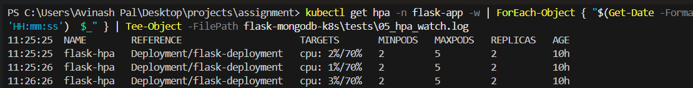
*HPA baseline: 2 replicas operating at idle CPU (~2%).*

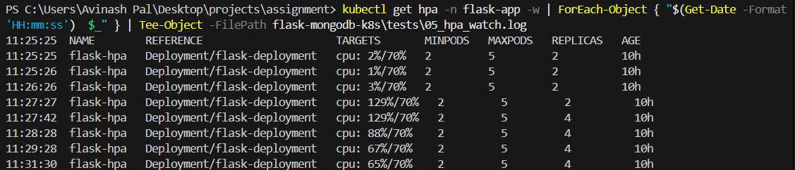
*HPA scaling up: CPU utilization surges past the 70% threshold under load.*

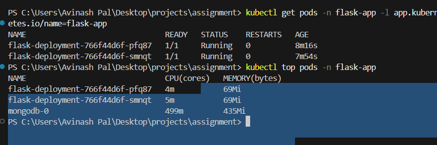
*HPA peak load: 4 replicas running concurrently with load evenly balanced.*

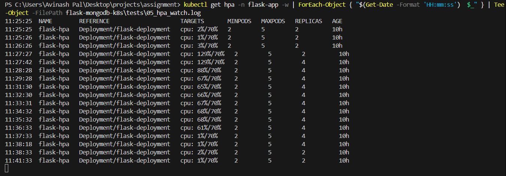
*HPA cool-down: traffic terminates, stabilization window elapses, and deployment returns to 2 replicas.*

#### Issues Encountered & Engineering Mitigations

1. **Probe Cascade and Restart Storm Under Heavy Load**:
   - **Symptom**: Under sustained concurrent load during initial stress testing, both Flask application pods entered `CrashLoopBackOff` (accumulating 11–16 restarts), MongoDB transitioned to `Running 0/1`, the HPA reported `cpu: <unknown>/70%`, and no autoscaling occurred.
   - **Observed Evidence**:
     - MongoDB CPU utilization peaked and throttled at 501m against its strict 500m limit (`kubectl top pods`).
     - MongoDB logs showed slow operations taking between 15s and 37s to complete.
     - `kubectl describe pod mongodb-0` revealed exec probe failures: `command timed out: "sh -c mongosh ... timed out after 10s"`.
     - `kubectl describe pod` for Flask pods revealed liveness failures: `Liveness probe failed: Get "http://...:5000/health": context deadline exceeded`.
     - Kubelet terminated Flask pods via `SIGTERM` approximately 59 seconds after boot without any unhandled Python or application exceptions in the application logs.
   - **Hypothesis**: The hostPath volume mounted from the Windows/WSL2 host disk into the Minikube VM likely contributed disk I/O bottlenecks during high-concurrency write/read operations, exacerbating CPU throttling inside the container cgroups (plausible contributor, not proven).
   - **Root Cause Analysis**: Two compounding architectural coupling flaws:
     1. MongoDB's probes executed `mongosh` (a full Node.js V8 process) inside the container's 500m CPU budget. When MongoDB saturated the CPU, the Node.js runtime could not finish initialization within 10 seconds, causing the kubelet to mark MongoDB unready and kill it.
     2. Flask's `livenessProbe` was pointing to `/health`, which executes `client.admin.command("ping")` against MongoDB. Because liveness was coupled to database latency, MongoDB's slowness caused the kubelet to repeatedly kill healthy Flask pods, resulting in CrashLoopBackOff and metrics-server scrape failures.
   - **Engineering Fix Applied**:
     1. **Decoupled Flask Liveness from Database**: Switched `livenessProbe` in `k8s/05-flask-deployment.yaml` to `httpGet /` (process responsiveness only, 0 database queries, `timeoutSeconds: 5`, `failureThreshold: 5`). Kept `readinessProbe` on `/health` (so an unready database temporarily removes Flask from Service endpoints without killing the process).
     2. **Lightweight MongoDB TCP Probes**: Replaced all three heavy `mongosh` exec probes in `k8s/03-mongo-statefulset.yaml` with zero-overhead `tcpSocket: port: 27017` probes (`startupProbe` period 5s, failureThreshold 30; `livenessProbe` period 15s, timeout 5s, failureThreshold 6; `readinessProbe` period 10s, timeout 5s, failureThreshold 6).
   - **Result**: Cluster stability fully restored. Pods withstand database latency gracefully; Flask pods remain 1/1 Running without restarting.
   - *Historical Comparison with Run 1 (`tests/05a_hpa_run1_pre_probe_fix.log`)*: In that earlier pre-probe-fix run, the HPA scaled from 2 to 4 replicas, but then prematurely scaled back down to 2 while the load generator was still running due to metric scrape instability during container restarts, and the post-load cool-down was not captured. Decoupling the Flask liveness probe from the database, switching MongoDB to lightweight TCP probes, and generating load directly on `/` completely eliminated probe cascades, producing the stable, deterministic autoscaling behavior documented above.

2. **Metrics-Server Initial Polling Lag (`<unknown>`)**:
   - *Observation*: Immediately following a deployment rollout, `kubectl get hpa` reports `cpu: <unknown>/70%` for roughly 30 to 45 seconds.
   - *Mitigation*: Documented as expected Kubernetes metrics-server behavior; the metrics scraper queries the kubelet summary API on a 30-second cadence.

---

### 6. Container Image & Registry Verification

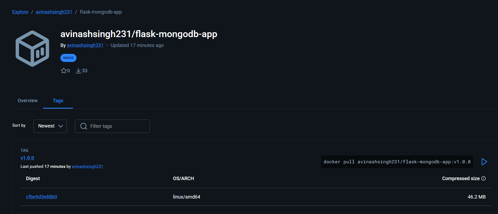
*Docker Hub container registry showing `avinashsingh231/flask-mongodb-app:v1.0.0` repository and tag.*

---

## 11. Known Gotchas & SRE Observations

1. **`MONGO_INITDB_*` Requires an Empty Directory**:
   MongoDB's entrypoint script (`docker-entrypoint.sh`) only evaluates root credentials and creates the admin user if `/data/db` is completely empty. If the container is restarted with pre-existing data files from an unauthenticated session, initialization is skipped.
2. **`command` vs `args` in Docker Containers**:
   Specifying `command: ["mongod"]` in Kubernetes overrides the container's `ENTRYPOINT`, which completely bypasses `docker-entrypoint.sh` and skips user creation. The correct approach is omitting `command` and passing arguments via `args: ["mongod", ...]`.
3. **MongoDB Probe Mechanism (TCP Socket vs exec mongosh)**:
   MongoDB images provide `mongosh` as the default interactive shell, which is an entire Node.js V8 application. Executing `mongosh` inside a container constrained to a 500m CPU limit creates severe CPU contention and probe timeouts under load. Replacing exec probes with native `tcpSocket` probes on port 27017 eliminates process spawning overhead, delegating connection validation directly to the kubelet. Note the engineering trade-off: a TCP probe verifies that the database listener port is open and accepting sockets, while database authentication and query execution are verified separately through dedicated end-to-end test suites.
4. **HPA `<unknown>` Status**:
   Immediately after deploying an HPA, `kubectl get hpa` displays `cpu: <unknown>/70%`. This is expected behavior while `metrics-server` completes its first 30-60 second polling cycle.
5. **Minikube Docker Driver Networking on Windows**:
   Because Docker Desktop runs within a WSL2 / Hyper-V VM, NodePorts on the Minikube node IP are not directly routable from the Windows host network. Running `minikube service flask-service -n flask-app --url` or `kubectl port-forward` bridges host traffic into the cluster.

---

## 12. Troubleshooting & Cleanup

### Troubleshooting Commands
```bash
# Check pod events and termination reasons
kubectl describe pod <pod-name> -n flask-app

# Inspect live application logs
kubectl logs -n flask-app deployment/flask-deployment -c flask-app --tail=50 -f
kubectl logs -n flask-app mongodb-0 --tail=50 -f

# Check real-time resource utilization
kubectl top nodes
kubectl top pods -n flask-app

# Inspect HPA events
kubectl describe hpa flask-hpa -n flask-app
```

### Complete Cleanup
```bash
# Delete all resources in the flask-app namespace and the PV
kubectl delete namespace flask-app
kubectl delete pv mongo-pv

# Stop Minikube cluster
minikube stop
```

---

## 13. Future Production Improvements

1. **MongoDB Replica Set with Operator**: Migrate standalone MongoDB to a 3-node replica set using the MongoDB Community Kubernetes Operator for automated backups, rolling updates, and automatic primary failover.
2. **Ingress with TLS Termination**: Deploy an Ingress Controller (`ingress-nginx`) with `cert-manager` for automated Let's Encrypt SSL/TLS certificates and path-based routing.
3. **Secrets Management**: Replace base64/stringData Kubernetes secrets with HashiCorp Vault or AWS Secrets Manager via the External Secrets Operator (ESO).
4. **CI/CD Pipeline**: Implement GitHub Actions workflows to run unit tests, trigger security scanning (Trivy), build signed multi-arch container images, and deploy via Helm or ArgoCD (GitOps).
